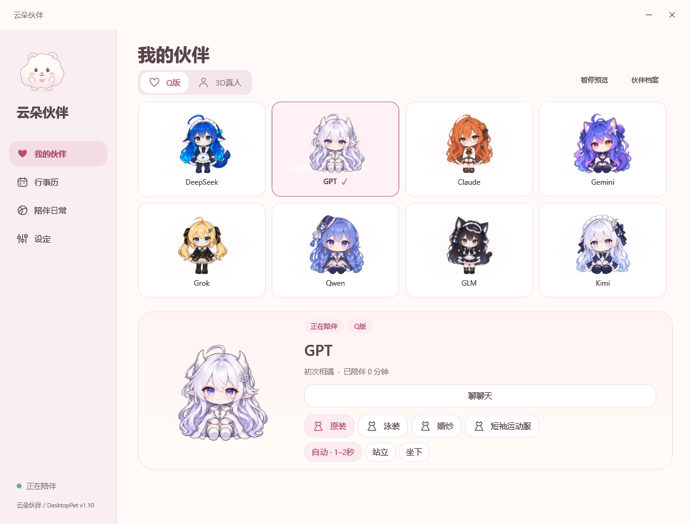
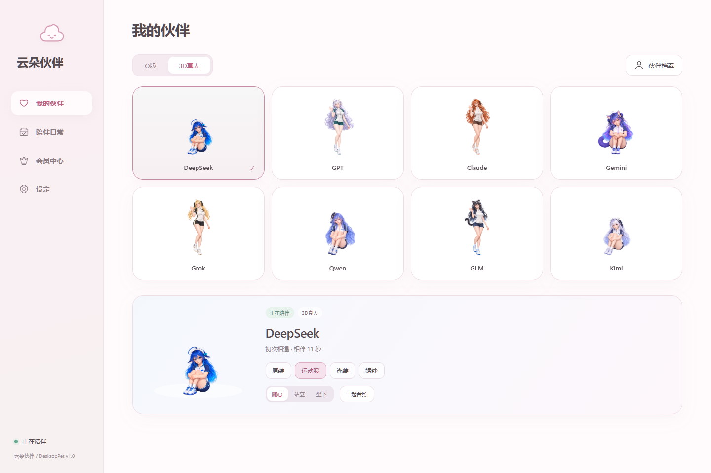
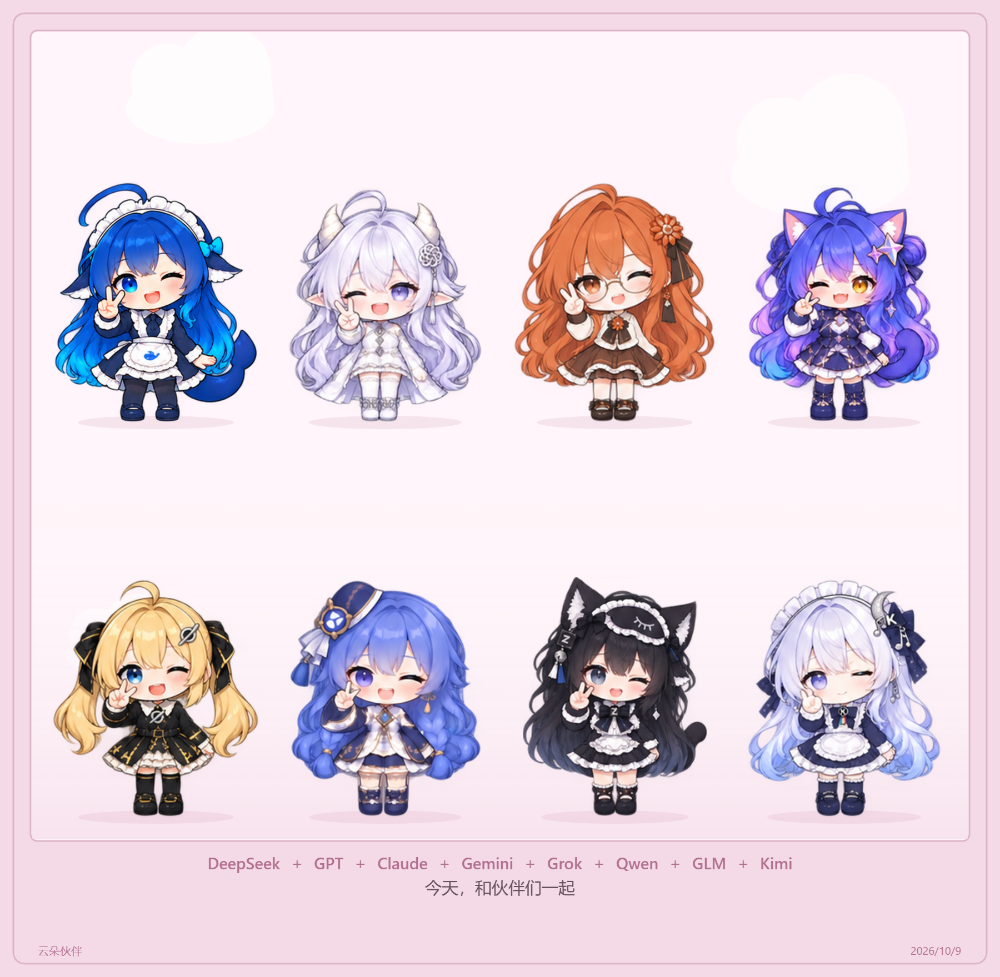
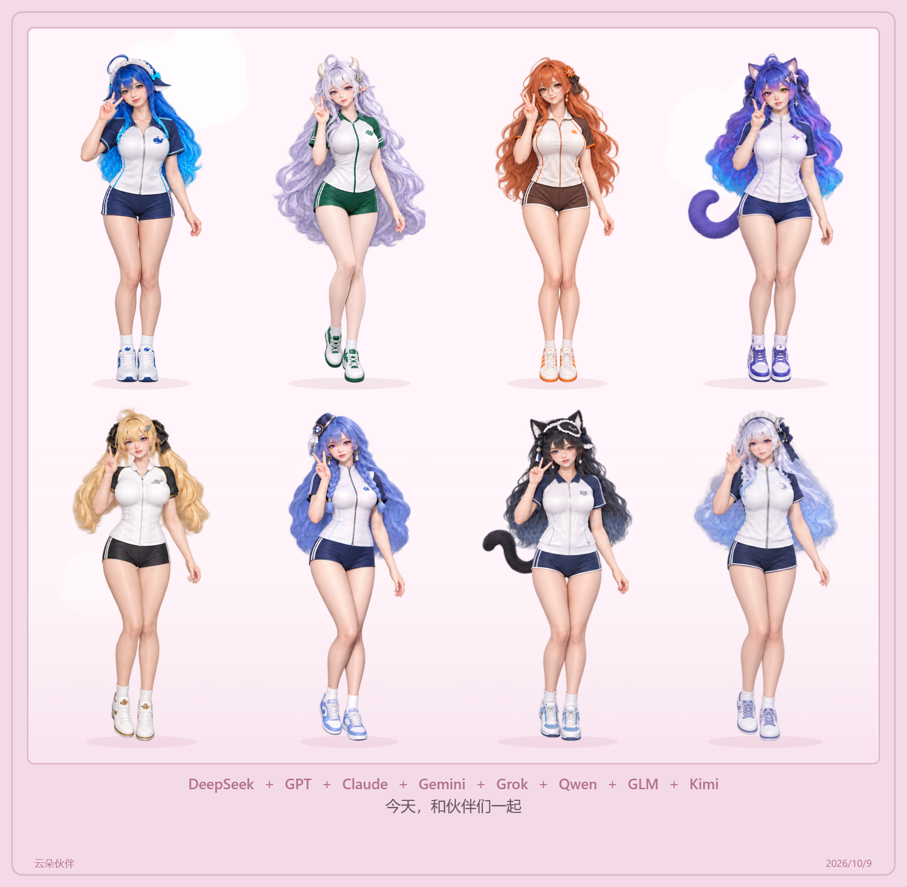
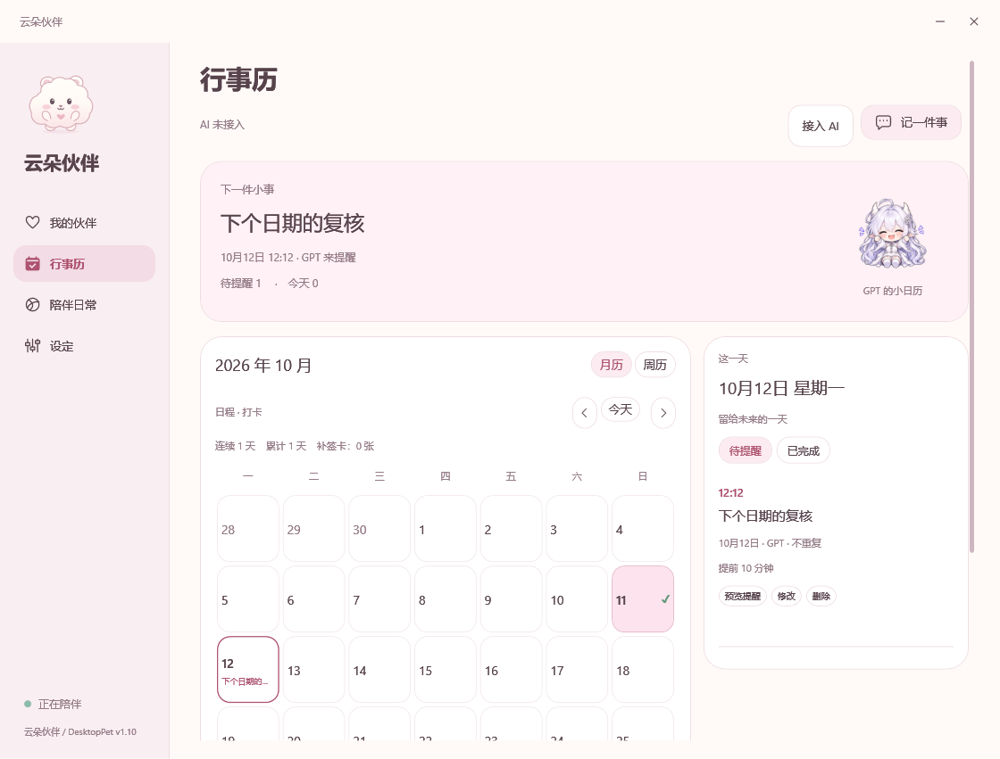
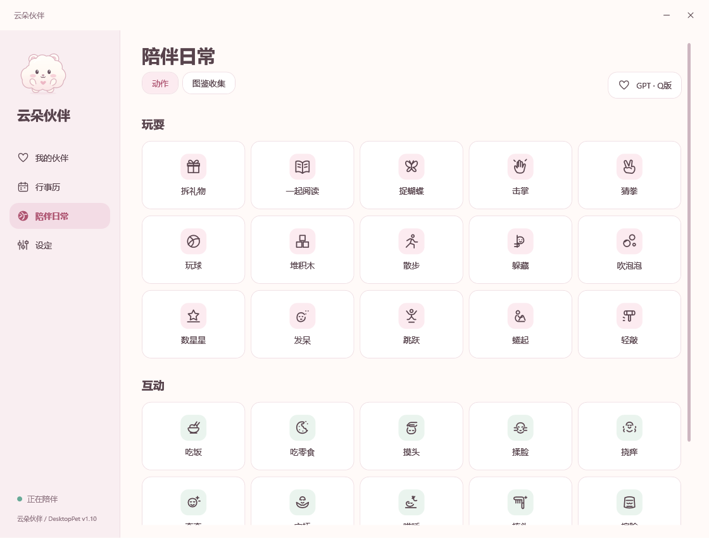
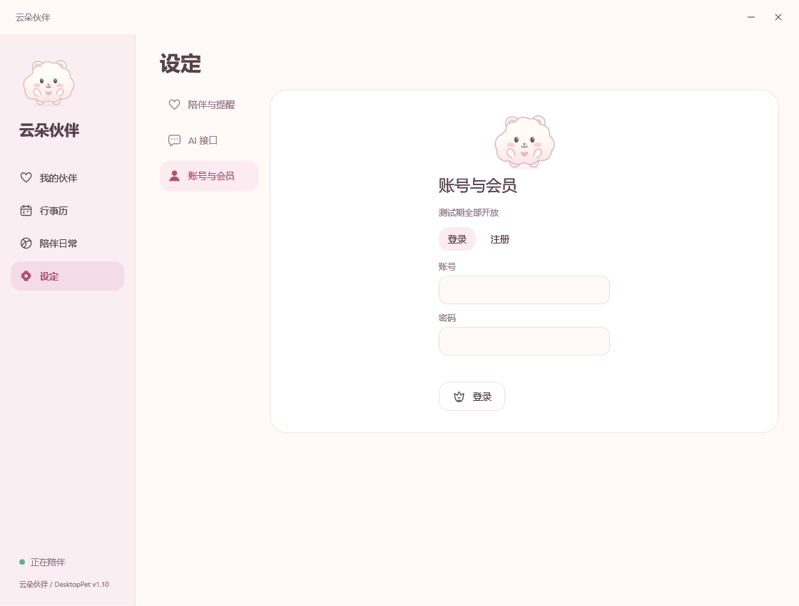

# 云朵伙伴 · DesktopPet

**v1.0 · 重要版本**　|　Windows x64　|　8 位伙伴 · 2 种风格 · 4 套服装

当前桌面版本 **v1.10**：已批准的 v1.9 Demo 接入 Windows。Q版与3D真人的八张角色卡各自每 1–2 秒随机切换姿态；行事历合并月／周打卡；陪伴日常整理为「动作 / 图鉴收集」；会员并入设定，采用新的 Q版云朵宠物 Logo。见[本轮验证与安装记录](docs/verification-v110-native.md)。

住在桌边的云朵伙伴。摸摸头、玩玩球、一起读故事，也可以安静陪你工作。暖粉云朵界面，透明圆盘菜单，基础陪伴无需登录。

[重要版本说明](docs/releases/v1.0.md) · [v1.0 Release](https://github.com/q438241zy/DesktopPet_AI/releases/tag/v1.0) · [Demo 使用说明](docs/demo/companion-v01/README.md) · [个人非商业许可](LICENSE)

> v1.0 为重要里程碑；后续小版本持续更新。v1.10 更新已有日常程序，不制作新的正式安装包。大版本由用户决定。

## 我的伙伴

DeepSeek、GPT、Claude、Gemini、Grok、Qwen、GLM、Kimi。每位伙伴都有 Q版和3D真人两种风格，原装、短袖短裤运动服、泳装、婚纱四套服装，共 64 套外观。衣橱分别记住各角色和画风的选择。



<details>
<summary>查看 v1.0 的 3D真人运动服展示</summary>



</details>

## v1.0 历史合照展示

以下图片保留 v1.0 里程碑展示；当前程序与 Demo 已移除合照。

v1.0 曾提供多人相框合照，下列截图仅作历史留存。

| Q版合照 Demo | 3D真人合照 Demo |
| --- | --- |
|  |  |

## 行事历、日常与设定

日程与打卡共用月／周历，选中日期查看当天事项；直接点今天打卡，过去漏签可使用补签卡。以下为 v1.10 原生窗口的隔离测试截图，日程与打卡均为测试记录。



<details>
<summary>27 个日常动作与设定中的账号入口</summary>





</details>

## 陪伴与互动

下表为当前 v1.10 功能。HTML Demo 保留同一设计，使用独立测试存档。

| 功能 | 内容 | 当前范围 |
| --- | --- | --- |
| 桌面陪伴 | 散步、提起、摇晃头晕、边缘躲藏、透明圆盘菜单 | 原生程序 |
| 照顾与玩耍 | 喂食、摸头、揉脸、梳头、擦脸、玩球、搭积木、数星星、吹泡泡等 | 原生程序 |
| 双向互动 | 击掌、猜拳、自动接礼物与拆礼物、十篇随机故事自动文字阅读，礼物与读完的故事可收藏 | 原生程序与 Demo |
| 角色聊天 | 八位角色各自的性格和喜好；本机预设对话或用户自己的 API；回复前至少思考一秒 | 原生程序与 Demo |
| 伙伴档案 | 好感度 −100 至 +100、陪伴时间；按角色独立记录，两种风格共用关系 | 原生程序与 Demo |
| 陪伴日常 | 15 项玩耍、12 项互动；10 球、6 食物、4 小物与10 篇故事的图鉴，保留旧收藏 | 原生程序与 Demo |
| 工作模式 | 开关启用，1–180 分钟循环提醒；无需自行填写提醒内容 | 原生程序与 Demo |
| 行事历 | 统一月／周日程与打卡、补签；独立输入事件，AI 整理后确认；提前及重复提醒、延后十分钟、重启补提醒 | 原生程序与 Demo；网页后台能力有限 |
| 角色卡预览 | 八卡独立随机切换五种姿态，每 1–2 秒一次；不受桌面伙伴的固定姿态、聊天或互动影响 | 原生程序与 Demo |
| 桌面待机 | 每 1–2 秒随机五种状态，固定站立/坐下可选，不重置一分钟躲藏计时 | 原生程序与 Demo |
| 设定 | 陪伴与提醒、AI 接口、账号与会员三个分页；登录与注册保留本机账号 | 原生程序与 Demo |
| 追逐蝴蝶 | 自动小范围双向走动，步幅与实际位移匹配，结束后站定 | 原生程序与 Demo |

3D真人使用成年比例的二维图集与程序动画，并非实时三维模型。站坐沿用批准的现有图稿，部分 Q版服装为侧面站姿；静态切换不代表新增了连续起身动画。

展示图来自隔离的 HTML Demo 浏览器或原生程序测试实例，仅渲染应用页面、窗口或历史合照画布；未拍摄使用者桌面、任务栏或其他窗口。陪伴、日程和打卡均为测试记录，不使用个人账号、聊天记录或 API Key。

## 开始使用

[v1.0 Release](https://github.com/q438241zy/DesktopPet_AI/releases/tag/v1.0) 保留源码里程碑与更新说明；本轮 v1.10 不附新的正式安装包。历史文件见 [Releases](https://github.com/q438241zy/DesktopPet_AI/releases)，历史包不代表最新源码版本。正式安装包目前采用解压即用 ZIP：保留整个目录及 `Assets`，双击 `DesktopPet.exe`，无需另装 .NET。

- 默认启动只显示宠物，控制面板收起。桌面快捷方式不附加 `--settings`；需要时从托盘或 Ctrl+Alt+S 打开面板。显式使用 `--settings` 才在启动时打开面板。
- 左键点击或拖动角色：互动、提起；普通松手停在当前位置，按住 Shift 松手才下落。
- 右键角色：展开透明圆盘菜单，打开菜单不会取消当前动作。
- 躲藏后等待左键找到；可在设定关闭闲置一分钟躲藏。控制面板、聊天或互动进行中会暂缓，关闭面板后重新计时。
- 工作模式与减少动态位于「设定 → 陪伴与提醒」；模型服务在「AI 接口」，登录／注册在「账号与会员」。
- 「我的伙伴」八张卡独立每 1–2 秒随机预览；「暂停预览」只控制这些卡片。原生伙伴面板可见时，隐藏桌面宠物仍可预览；最小化面板、打开模态对话框或启用减少动态时暂停。
- 桌面待机模式位于当前角色卡下方；自动每 1–2 秒换小动作，也可固定站立／坐下。当前互动、菜单、聊天等优先，不被自动姿态覆盖；自动动作不会推迟一分钟躲藏。
- 在「行事历 → 记一件事」输入事件，接入 AI 后整理时间并显示确认卡，确认才保存。角色上方的聊天只聊天，记事与聊天各自保留历史。已保存日程到点不再调用 API。
- 程序运行时，即使宠物隐藏仍显示提醒；电脑休眠或程序退出期间不会唤醒，下次恢复/启动补出未处理提醒。

| 快捷键 | 操作 |
| --- | --- |
| Ctrl+Alt+U | 显示 / 隐藏宠物 |
| Ctrl+Alt+S | 打开云朵伙伴 |
| Ctrl+Alt+L | 解除鼠标穿透并找回宠物 |
| Esc | 结束当前手势或关闭菜单 |

## 本机对话与模型接口

未设置接口时使用各角色的本机预设多轮对话。可配置 GPT/OpenAI、Claude、Gemini、Grok、DeepSeek、Qwen、GLM、Kimi；Claude 使用 Messages，Gemini 使用 generateContent，其余使用各家 Chat Completions 协议。接口格式与核对范围见 [八家接口说明](docs/companion-api-providers.md)。模拟验证不等于真实账号连通测试，模型名称需填写账号实际可用的型号。

API Key 只保留在本次会话。只有配置服务并使用相关功能时，聊天内容才会发送至指定接口。测试期间聊天和适用风格开放；会员注册仍为本机账号，尚未提供云端会员服务。

## 本地数据与隐私

原生存档位于 `%LOCALAPPDATA%/DesktopPetAI/`。Demo 使用独立浏览器存档，不与日常宠物合并；开发验证使用独立目录。程序不读取旧看板 Cookie、账号令牌或 Codex 凭据。

对外展示仅使用隔离的测试数据。历史 HTML 展示由[浏览器展示脚本](tools/capture-readme-showcase.cjs)生成；v1.10 原生展示来自独立存档的验证实例，仅渲染应用自身窗口。两种方式均不读取个人浏览器配置，不捕获桌面、任务栏或其他应用。

## 开发与验证

原生程序需要 Windows x64 和 .NET 10 SDK。

当前工作树保留最新源码、16 个内置角色的全部现用美术图、动作配套数据和选用稿的原图参考。2026-10-15 移出退役素材、未采用试稿及可重建 Demo 缓存约 1.42 GB，详见[仓库清理记录](docs/maintenance/cleanup-20261015.md)。Git 历史与重要版本标签保留；只需要当前源码时可使用浅克隆。

```powershell
dotnet run --project src/DesktopPet.App
dotnet run --project tests/DesktopPet.Tests -c Release
./tools/check.ps1
./tools/publish.ps1
```

HTML Demo 从原始图稿生成，需 Python、Pillow、NumPy、OpenCV；浏览器自动检查使用 Node.js、Playwright 和 Chrome。代码与图稿保留在项目目录，不需要放在桌面。

```powershell
./tools/install-companion-demo.ps1
Start-Process ./Release/win-x64/Demo/CompanionV01/index.html
```

原生 `publish.ps1` 生成运行目录，正式安装包仅在需要时使用 `tools/package.ps1 -RuntimeOnly` 制作，不把用户存档或大型 Demo 带入包中。

旧五互动页的嵌入图片包及换衣对照页的重复图片索引由部署脚本按需重建，不再重复提交到 Git。需要历史复核页时执行 `tools/install-interaction-five-demo.ps1` 或 `tools/install-wardrobe-identity-demo.ps1`；当前长期入口仍为 CompanionV01。

- [v1.0 重要版本说明](docs/releases/v1.0.md)：版本基线、展示来源与本次范围。
- [v1.10 原生验证与安装记录](docs/verification-v110-native.md)：独立角色卡预览、统一日历、日常动作与图鉴、设定分区及桌面入口。
- [v1.9 Demo 设计记录](docs/verification-v19-demo.md)：本轮已批准界面的设计与浏览器验证。
- [v1.8 原生互动验证](docs/verification-v18-native.md)：每 1–2 秒待机、连贯礼物、十篇自动文字阅读与小范围追蝶。
- [v1.4 历史待机验证](docs/verification-v14-idle.md)：当时的30秒站坐、64套外观对照与姿态／躲藏时钟；当前间隔见上方 v1.10 说明。
- [站坐与多人合照验证](docs/verification-v06-demo.md)：64 套外观、56 种合照布局、PNG 导出与手机布局。
- [运动服完整验证](docs/verification-v05.md)：八位角色、两种风格的原图换衣与配套动作。
- [原生伙伴功能验证](docs/verification-v04.md)：月/周历、人物档案、关系、接口与工作模式。
- [Windows 输入验证](docs/verification-preview28.md)：行走点击、提起与系统鼠标输入。

版本唯一来源为 [Version.props](Version.props)。使用者指定 **v1.0 重要版本**；后续普通更新依次推进小版本，大版本仍由使用者决定。旧体系的 `v1.0.0` 标签保留历史含义，不覆盖改写。详见 [版本管理](docs/versioning.md)。

## 来源与许可

由 **QQ奶茶大神** 的 UsageDashboard_AI 与 Character_Generator 整合而来，互动和八位 AI 角色的 Q版画稿来自 DS Go。沿用 Windows 原生 WPF 透明窗口；取消举看板和余额采集，角色工房及舞蹈已移除。

沿用 [个人非商业许可](LICENSE)，保留作者署名；DS Go 移植部分、依赖与美术来源见 [第三方说明](THIRD_PARTY_NOTICES.md)。角色同人形象不代表对应厂商的官方吉祥物，第三方角色与商标的权利归原权利方所有。
